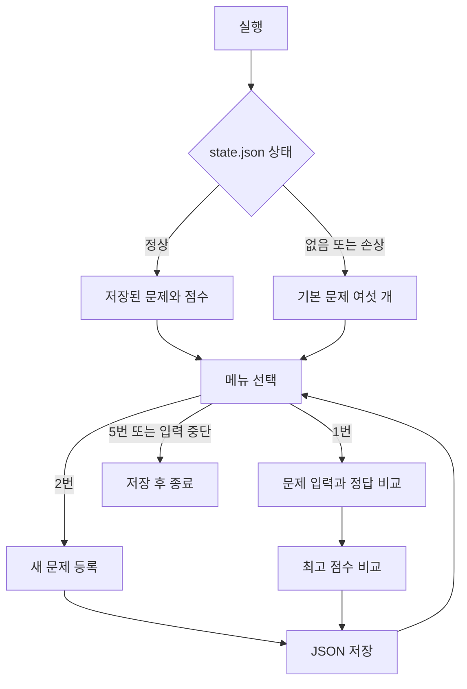

# 두 번째 과제 복습

완성된 프로그램을 실행하는 것과 코드를 이해하는 것은 다릅니다. 아래 내용은 직접 설명하고 수정하기 위한 복습 자료입니다. 40시간은 과제의 권장 학습량이며 실제 공부한 시간으로 기록하지 않습니다.

## 첫 번째 실습과 연결하기

이전에는 Docker 컨테이너 밖에 볼륨을 두어 파일을 남겼습니다. 이번에는 Python 프로그램 밖에 `state.json`을 두어 문제와 점수를 남깁니다. 실행 중인 프로그램의 변수는 종료하면 사라지지만 저장한 파일은 남습니다.



## 어디부터 읽을까

`main.py` → `input_helpers.py` → `quiz.py` → `default_quizzes.py` → `game.py` 순서로 읽습니다. 처음에는 `game.py`의 파일 복구 부분을 건너뛰고 `show_menu`, `play`, `add_quiz`부터 읽어도 됩니다.

| 개념 | 코드에서의 예 | 뜻 |
| --- | --- | --- |
| 변수 | `correct = 0` | 현재 정답 수를 가리키는 이름 |
| int | `answer = 2` | 정수 번호나 개수 |
| str | `question = "문제"` | 글자 데이터. input의 결과도 문자열 |
| bool | `True`, `False` | 참과 거짓, 계속 실행할지의 판단 |
| list | `choices`, `self.quizzes` | 순서가 있는 여러 항목 |
| dict | `{"correct": 4, "total": 6}` | 이름을 붙여 모은 데이터 |
| if/elif/else | `handle_selection` | 선택한 메뉴에 따라 동작 분기 |
| for | `for quiz in self.quizzes` | 준비된 문제를 하나씩 반복 |
| while | `while True` | 올바른 입력 또는 종료 선택이 올 때까지 반복 |
| 매개변수 | `read_number(prompt, minimum, maximum)` | 함수가 밖에서 받는 값 |
| 반환값 | `return value` | 호출한 곳으로 돌려주는 결과 |

`print`는 화면에 보여 주고, `return`은 값을 호출한 코드에 돌려줍니다. 출력만 하면 그 값으로 다음 계산을 할 수 있는 것은 아닙니다.

## 클래스 두 개를 둔 이유

`Quiz`는 문제 한 장입니다. 문제, 선택지, 정답을 가지고 출력과 정답 비교를 합니다. `QuizGame`은 전체 진행자입니다. 여러 문제와 최고 점수를 관리하고 메뉴를 반복합니다.

```python
quiz = Quiz("HP의 의미는?", ["해상도", "체력", "음량", "파일 수"], 2)
quiz.display()
is_correct = quiz.check_answer(2)
```

`Quiz`는 만드는 규칙인 클래스이고, `quiz`는 그 규칙으로 만든 객체입니다. `__init__`는 새 객체의 처음 값을 설정합니다. `self`는 지금 동작하는 그 객체를 가리킵니다. `self.question`은 속성, `display()`는 메서드입니다.

`@classmethod`가 붙은 `from_dict`는 JSON에서 읽은 dict를 새 Quiz 객체로 바꾸는 입구입니다. 반대로 `to_dict`는 Quiz를 JSON으로 저장할 수 있는 dict로 바꿉니다. 처음에는 이 두 방향만 이해하면 됩니다.

## 왜 int 변환 전에 검사할까

입력은 문자열입니다. `" 2 "`는 strip 후 `"2"`, int 변환 후 숫자 2가 됩니다. `"abc"`는 int로 바꿀 수 없어 ValueError가 납니다. try/except가 그 오류를 받아 다시 입력할 기회를 줍니다.

빈 입력은 read_text에서, 숫자로 바꿀 수 없는 입력은 except에서, 범위를 벗어난 숫자는 조건문에서 처리합니다. 이 세 경우를 한꺼번에 생각하지 말고 순서대로 따라가 보세요.

## 파일과 JSON

`with path.open(..., encoding="utf-8")`은 파일을 사용한 뒤 닫아 주는 방식입니다. `json.load`는 파일 내용을 dict와 list로 읽고, `json.dump`는 데이터를 JSON 글자로 씁니다. JSON은 클래스 자체를 저장하지 않으므로 Quiz와 dict를 서로 바꿉니다.

`None`은 JSON에서 `null`입니다. 최고 점수가 null이면 아직 완료한 게임이 없습니다. `{"correct": 0, "total": 6}`이면 게임을 끝냈지만 정답이 없었습니다.

임시 파일, 원본 백업, 파일 교체는 저장 중 실패해도 원본을 지키기 위한 추가 처리입니다. 기본 문법을 익힌 뒤 두 번째로 읽을 부분입니다.

## Git 명령 일곱 개

| 명령 | 역할 | 흔한 혼동 |
| --- | --- | --- |
| init | 현재 폴더에서 변경 기록 시작 | GitHub 저장소를 생성하는 명령은 아님 |
| add | 다음 커밋에 넣을 변경 선택 | 아직 커밋이 아님 |
| commit | 선택한 변경을 로컬 이력에 기록 | 아직 GitHub 업로드가 아님 |
| push | 로컬 커밋을 원격에 보냄 | 파일 저장과 별개의 작업 |
| clone | 원격의 파일과 이력을 새 폴더로 복제 | 이미 있는 작업 폴더를 갱신하는 용도가 아님 |
| pull | 기존 폴더에서 원격 변경을 가져와 통합 | 보통 fetch와 merge 또는 rebase를 결합 |
| checkout | 브랜치 전환, -b로 생성과 전환 | 파일 복원 용법도 있으므로 옵션 확인 |

이번에는 `git checkout -b feature/quiz-play`로 브랜치를 만들고 `git merge --no-ff feature/quiz-play`로 합쳤습니다. `--no-ff`를 써서 그래프에서 병합 지점을 볼 수 있습니다.

## 직접 해 볼 다섯 가지

1. 메뉴에 Enter, abc, 9, 공백을 붙인 3을 입력하고 차이를 설명합니다.
2. 게임 전시를 주제로 문제 한 개를 등록합니다. 종료하고 다시 실행해 목록에서 찾습니다.
3. 기본 문제 한 개의 선택지를 수정하고 실행 결과가 달라지는 이유를 설명합니다. 이미 state.json이 있으면 기본 데이터 변경이 바로 반영되지 않는다는 점을 확인합니다.
4. 기존 state.json을 다른 이름으로 보관하고 첫 실행 상태를 확인합니다. 보관한 파일을 지우지 않습니다.
5. `git diff`, `git add`, `git commit`을 직접 사용해 메뉴 문구 수정 기록을 남깁니다.

## 40시간 학습 배분 제안

| 학습 | 시간 |
| --- | ---: |
| 실행과 변수, 타입, 입출력 | 6 |
| 조건문, 반복문, 함수 | 8 |
| Quiz와 QuizGame 구조 설명 | 8 |
| JSON 읽기와 쓰기, 예외 처리 | 6 |
| Git 기능별 커밋과 브랜치, clone과 pull | 8 |
| 직접 수정, 오류 재현과 제출 설명 | 4 |

실제 학습 시간과 이해 여부는 아직 측정하지 않았습니다. 코드를 보지 않고 다섯 가지 연습을 설명할 수 있는지 확인한 뒤 학습 완료로 표시합니다.
